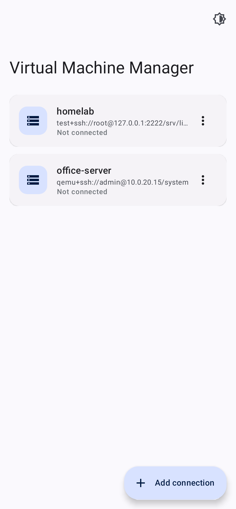
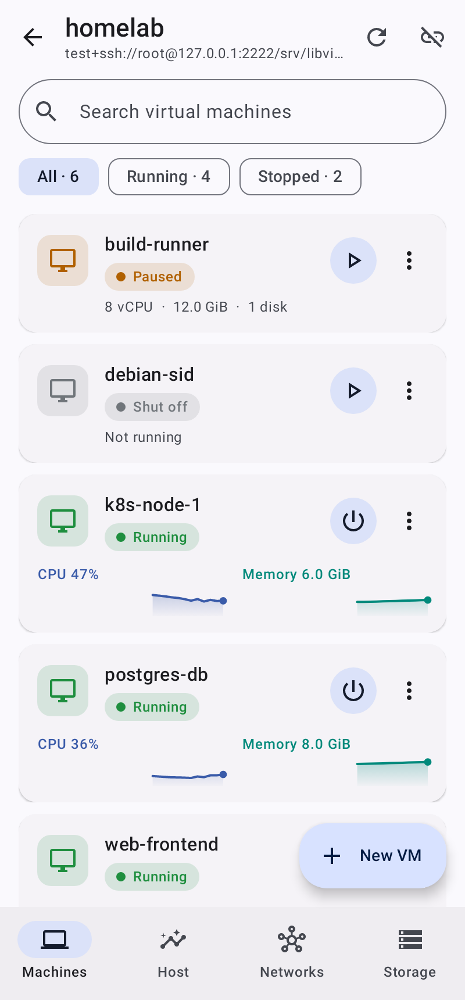
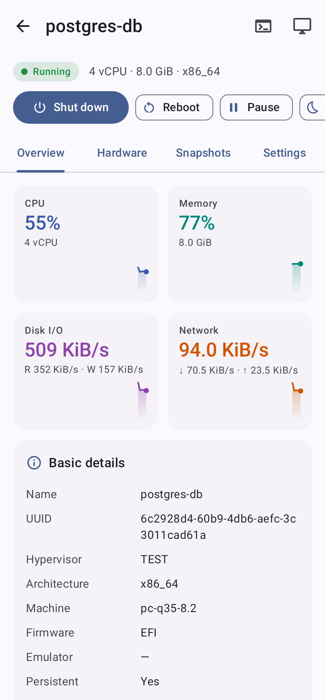
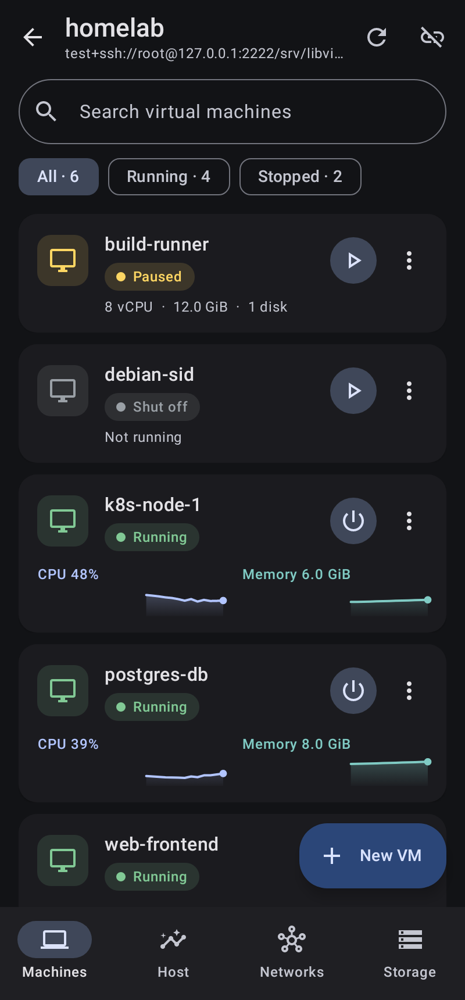
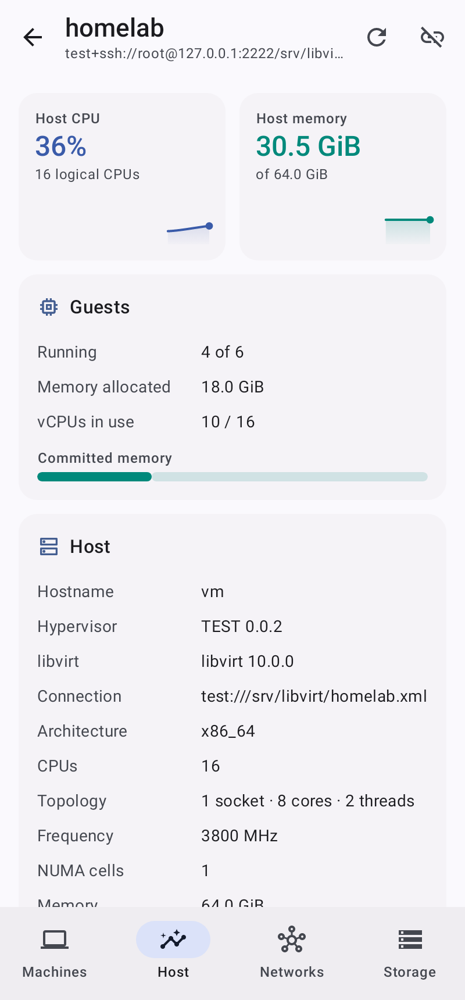
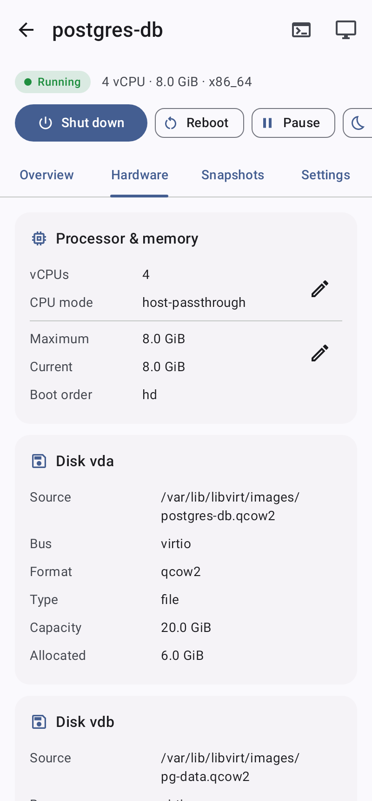
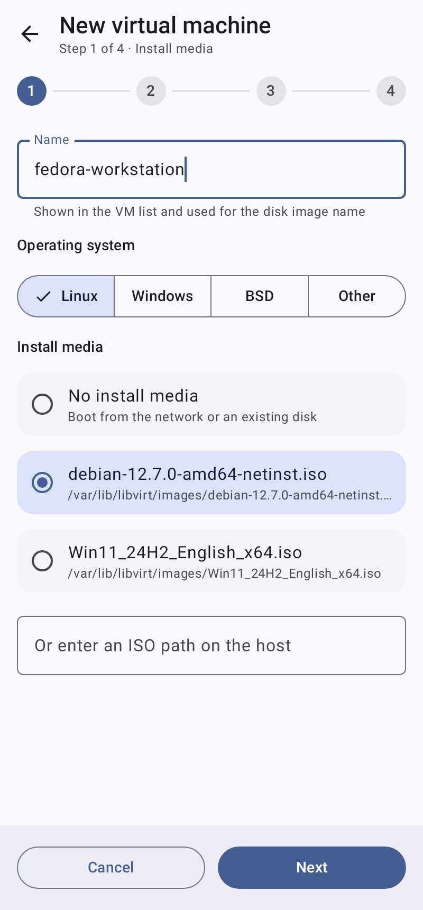
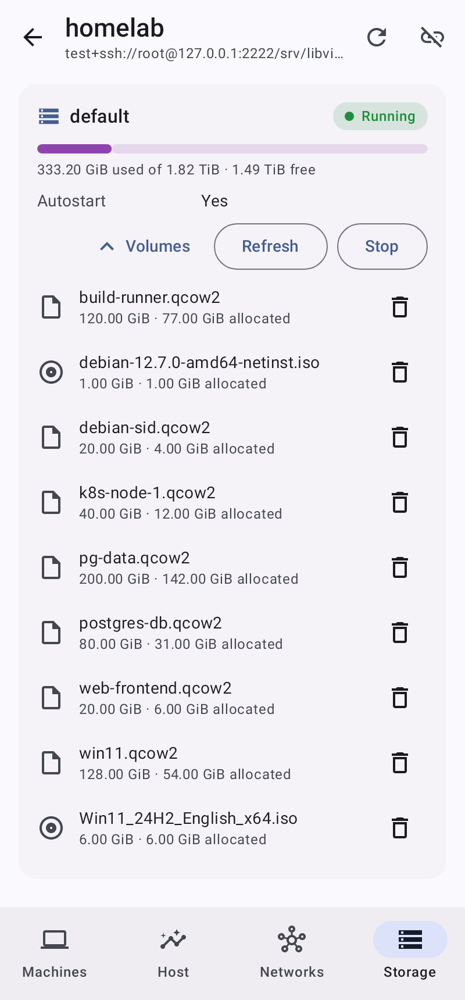

# Virt Manager for Android

A native Android port of [virt-manager](https://virt-manager.org/) with a modern
Material 3 / Jetpack Compose interface. Manage KVM/QEMU (and other libvirt) hosts
from your phone or tablet: start and stop guests, watch live performance graphs,
create VMs, take snapshots, and open the graphical (VNC) or serial console.

<p>
  
  
  
  
</p>
<p>
  
  
  
  
</p>

> The screenshots are recorded by `AppScreenshotTest`, which drives the real app over real SSH
> against libvirt's built-in test driver.

## How it works

virt-manager talks to remote hosts with `qemu+ssh://` URIs, i.e. it tunnels libvirt over SSH.
This port does the same thing without shipping libvirt for Android: the app opens an SSH
session to the host and drives the host's own `virsh`, parsing its output (and domain XML)
into typed models. Consoles reuse the same SSH session:

| Feature | Mechanism |
| --- | --- |
| VM list, live CPU / memory / disk / network graphs | `virsh domstats --raw` polled every 2 s, batched in one SSH round trip |
| Lifecycle (start, shut down, reboot, pause/resume, save, reset, force off) | `virsh start/shutdown/...` |
| Details, hardware, XML | `virsh dumpxml` parsed with a DOM parser |
| Edit vCPUs / memory, CD-ROM insert/eject, rename, autostart, delete | `virsh setvcpus/setmem/change-media/domrename/autostart/undefine` |
| Snapshots | `virsh snapshot-*` |
| New VM wizard | `virsh vol-create-as` + generated domain XML via `virsh define /dev/stdin` |
| Networks and storage pools/volumes | `virsh net-*`, `pool-*`, `vol-*` |
| Graphical console | Built-in RFB/VNC client through an SSH local port forward (TCP or UNIX socket displays, VNC password auth) |
| Serial console | `virsh console` in an SSH PTY |

Everything runs with `LC_ALL=C` so parsing never depends on the host locale, and every
argument is shell-quoted.

### Features

- **Connections** – multiple hosts, `qemu:///system`, `qemu:///session`, LXC, Xen or any
  custom libvirt URI; password or SSH key auth (paste, import, or generate an Ed25519 key in
  the app and copy the public key); optional `sudo -n`; SSH compression; auto-connect.
- **Security** – trust-on-first-use host key verification with fingerprint confirmation and a
  loud warning if a key changes; stored passwords/keys are encrypted with an AES-GCM key held
  in the Android Keystore; backups of app data are disabled.
- **Machines** – search, filter by state, per-VM CPU and memory sparklines, one-tap primary
  action plus a full action menu; confirmations for destructive actions.
- **VM details** – Overview (CPU, memory, disk I/O and network tiles with history), Hardware
  (CPU, memory, disks, NICs, displays), Snapshots, Settings (autostart, rename, XML, delete
  with optional storage removal).
- **New VM wizard** – virt-manager's four steps: install media (ISOs discovered in the host's
  pools, or a path), memory and CPUs (bounded by the host), storage (qcow2 in a chosen pool),
  network (virtual network / bridge / none) plus UEFI and start-after-create. OS-aware
  defaults: virtio for Linux/BSD, SATA + e1000e + Hyper-V enlightenments for Windows, `virt`
  machine + UEFI on aarch64 hosts.
- **Host** – host CPU and memory graphs, committed memory, hypervisor/libvirt versions, CPU
  topology. **Networks** – start/stop, autostart, mode, bridge, DHCP range. **Storage** –
  pool usage, start/stop/refresh, browse and delete volumes.
- **Consoles** – immersive VNC viewer with pinch-zoom/pan, tap = click, long-press = right
  click, drag = drag, two-finger scroll, soft keyboard with sticky Ctrl/Alt/Super, special
  keys, F1–F12 and Ctrl+Alt+Del/F-keys; plus a serial terminal with quick keys.
- **Modern UI** – Material 3, dynamic color (Android 12+) with a matching fallback palette,
  light/dark/system theme, edge-to-edge, animated navigation.

## Host requirements

- An SSH server and `virsh` (package `libvirt-clients` / `libvirt-client`) on the host.
- The SSH user must be allowed to use the chosen URI: for `qemu:///system` that usually means
  membership in the `libvirt` group, logging in as root, or enabling **Use sudo** with
  passwordless sudo for `virsh`.
- For the graphical console the VM needs a VNC display (VMs created by the app get one
  listening on `127.0.0.1`, which is reached through the SSH tunnel). SPICE-only VMs can use
  the serial console or get a VNC display added.

## Building

Requirements: JDK 17+, Android SDK with platform 35.

```bash
./gradlew assembleDebug          # app/build/outputs/apk/debug/app-debug.apk
./gradlew testDebugUnitTest      # unit tests
./gradlew lintDebug
```

`minSdk` is 26 (Android 8.0). The project uses Kotlin 2.0, Compose (BOM 2024.12), Navigation
Compose with type-safe routes, DataStore, [JSch (mwiede fork)](https://github.com/mwiede/jsch)
for SSH and Bouncy Castle for Ed25519/Curve25519 (Android ignores the multi-release JDK
classes JSch would otherwise use, so the app configures JSch's Bouncy Castle implementations).

### Tests

The unit tests cover the virsh output parsers, domain XML generation (round-tripped through
the parser), command quoting and batching, metrics math, the serial terminal model, and the
RFB client against an in-process fake VNC server.

Opt-in integration tests run against real services when these variables are set:

| Variable | Purpose |
| --- | --- |
| `VMA_IT_SSH_PORT`, `VMA_IT_SSH_KEY` (`VMA_IT_SSH_USER`, default `root`) | sshd on 127.0.0.1 with `virsh` installed. `SshIntegrationTest` uses `test:///default` to cover host-key TOFU, polling, XML, stdin, PTY and port forwarding. |
| `VMA_IT_VNC_PORT`, `VMA_IT_VNC_PW_PORT` + `VMA_IT_VNC_PW` | QEMU VNC displays (e.g. `qemu-system-x86_64 -display none -vnc 127.0.0.1:5`). `QemuVncIntegrationTest` renders the framebuffer and checks VNC password auth through the SSH tunnel. |
| `VMA_IT_TESTNODE` | Path to a libvirt test-driver node XML on that host; `AppScreenshotTest` runs the app under Robolectric and records `docs/screenshots`. |

## Project layout

```
app/src/main/java/dev/virtmanager/android/
├── libvirt/   Models, virsh output/XML parsers, VirshClient, domain XML builder
├── ssh/       JSch session: exec, PTY, port forwarding, TOFU host keys, key generation
├── vnc/       RFB client and X11 keysyms
├── data/      Connection profiles (DataStore), Keystore secret encryption,
│              connection manager, metrics tracker
└── ui/        Compose screens: connections, host (machines/overview/networks/storage),
               VM details, new VM wizard, VNC and serial consoles, theme and components
```

## Limitations

- No SPICE client; the VNC client supports Raw and CopyRect encodings (plus DesktopSize),
  which QEMU always offers. SSH compression is enabled by default to keep this fast.
- Talks to libvirt via `virsh` rather than the libvirt RPC protocol, so the host needs
  `virsh` and SSH access (exactly what `qemu+ssh://` in virt-manager needs as well).
- Migration, device hot-plug, and advanced XML editing are not implemented yet.
